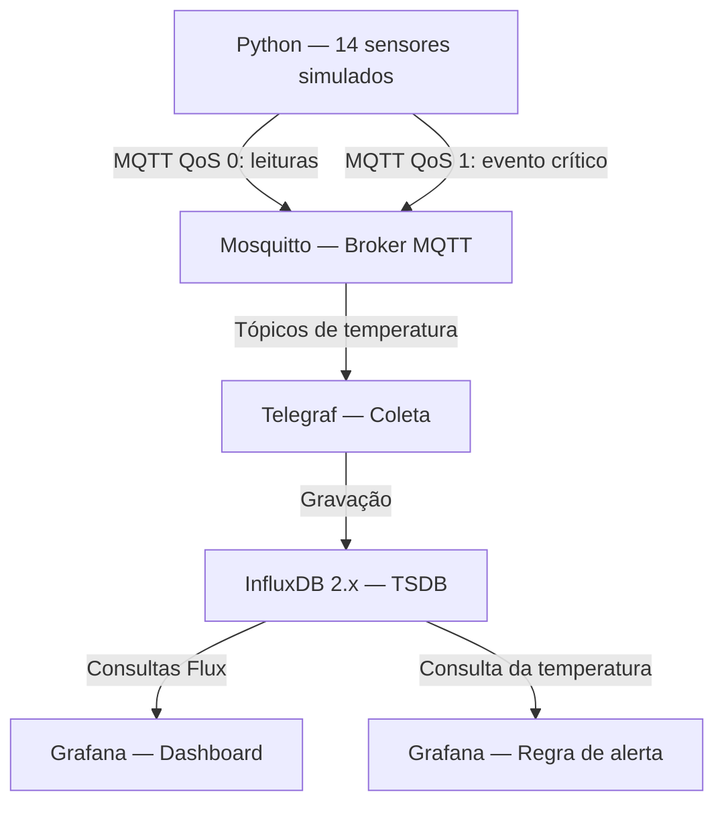

# FrioCerto — Sistema IoT de Monitoramento de Câmaras Frias

## 1. Cenário

A FrioCerto é uma rede fictícia de 14 farmácias do ABC Paulista que necessita monitorar câmaras frias destinadas ao armazenamento de medicamentos termolábeis. O sistema registra temperatura e umidade, monitora a faixa segura de 2 °C a 8 °C e identifica anomalias térmicas.

## 2. Arquitetura

O laboratório utiliza os seguintes componentes:

- **Python + Paho MQTT:** simula leituras dos 14 sensores.
- **Mosquitto:** broker responsável por receber e distribuir mensagens MQTT.
- **Telegraf:** consome as leituras MQTT e as encaminha ao banco de dados.
- **InfluxDB 2.x:** armazena as medições como séries temporais.
- **Grafana:** consulta os dados, apresenta gráficos e avalia regras de alerta.
- **Docker Compose:** gerencia os quatro serviços da infraestrutura.

### Diagrama



O simulador publica um evento MQTT próprio quando identifica uma anomalia prolongada. O Grafana possui uma regra independente que avalia as temperaturas armazenadas no InfluxDB.

## 3. Estrutura do repositório

```text
friocerto-iot/
├── docker-compose.yml
├── README.md
├── .env.example
├── .gitignore
├── mosquitto/
│   └── config/
│       └── mosquitto.conf
├── telegraf/
│   └── telegraf.conf
├── simulator/
│   └── publisher.py
└── screenshots/
```

Os arquivos `.env` e `.venv/` são locais e não devem ser versionados.

## 4. Como executar

### Pré-requisitos

- Docker Desktop com Docker Compose
- Python 3
- Git
- VS Code ou outro editor de código

### Configuração inicial

Na pasta raiz do projeto, crie um arquivo `.env` utilizando `.env.example` como referência.

Configure as variáveis:

```dotenv
INFLUXDB_ADMIN_PASSWORD=sua-senha
INFLUXDB_TOKEN=seu-token
GRAFANA_ADMIN_PASSWORD=sua-senha
```

Utilize valores próprios e não publique credenciais reais no repositório.

### Inicializar a infraestrutura

Abra o terminal na pasta do projeto e execute:

```powershell
docker compose up -d
```

Verifique os serviços:

```powershell
docker compose ps
```

O resultado esperado são quatro contêineres ativos e saudáveis: Mosquitto, Telegraf, InfluxDB e Grafana.

### Acessos

| Serviço | Endereço | Usuário |
|---|---|---|
| InfluxDB | http://localhost:8086 | admin |
| Grafana | http://localhost:3000 | admin |
| Mosquitto | localhost:1883 | Cliente MQTT |

As senhas são definidas no arquivo `.env`.

O InfluxDB utiliza a organização `friocerto` e o bucket `friocerto`.

## 5. Executar o simulador

No terminal do VS Code, crie o ambiente Python:

```powershell
python -m venv .venv
```

Instale a biblioteca utilizada pelo simulador:

```powershell
.\.venv\Scripts\python.exe -m pip install paho-mqtt
```

Execute:

```powershell
.\.venv\Scripts\python.exe simulator\publisher.py
```

O script simula 14 sensores e publica leituras a cada 2 segundos no laboratório. No cenário real, o intervalo previsto é de 60 segundos.

As mensagens seguem a estrutura:

```text
friocerto/abc/loja_01/temperatura
friocerto/abc/loja_02/temperatura
...
friocerto/abc/loja_14/temperatura
```

### Testar a anomalia

Após aproximadamente 60 segundos de execução, a `loja_07` passa a registrar 12,4 °C, acima do limite de 8 °C.

Após mais de cinco minutos de anomalia, o simulador publica um evento crítico no tópico:

```text
friocerto/abc/loja_07/alerta
```

Para visualizar as mensagens recebidas pelo broker, abra outro terminal e execute:

```powershell
docker compose exec mosquitto mosquitto_sub -h localhost -t "friocerto/abc/#" -v
```

Esse comando permite acompanhar tanto as leituras quanto os eventos de alerta publicados.

## 6. Monitoramento no InfluxDB e Grafana

O Telegraf transforma as mensagens JSON em medições no InfluxDB, utilizando:

- Measurement: `leituras_temperatura`
- Tag: `loja_id`
- Fields: `temperatura` e `umidade`
- Timestamp: horário da medição

O Grafana utiliza o InfluxDB como fonte de dados.

### Dashboard

O dashboard **FrioCerto | Monitoramento de Câmaras Frias** apresenta um gráfico temporal com as temperaturas das 14 lojas.

O período de visualização utilizado é de 15 minutos, permitindo acompanhar as oscilações e identificar a anomalia da loja 07.

O dashboard foi configurado na interface do Grafana. Em uma nova instalação, será necessário recriá-lo ou importá-lo caso seu JSON tenha sido exportado.

### Regra de alerta

A regra **FrioCerto - Temperatura alta por 5 minutos** utiliza:

- Consulta das temperaturas no InfluxDB.
- Condição: temperatura acima de 8 °C.
- Avaliação periódica: 30 segundos.
- Período pendente exigido: 5 minutos.
- Instâncias de avaliação separadas por loja.

O teste da condição identifica a anomalia da loja 07 sem afetar as demais lojas.

A comprovação do disparo efetivo deve ser feita pelo estado `Firing` da instância ou pelo histórico de alertas, com a duração de cinco minutos configurada.

## 7. Decisões técnicas

### Por que MQTT e quais níveis de QoS?

Escolhemos MQTT pelo modelo Publish/Subscribe, que permite distribuir mensagens dos sensores para diferentes consumidores sem configurar individualmente cada destino.

As leituras normais utilizam **QoS 0**, reduzindo o overhead das transmissões periódicas. Em produção, a preservação do histórico exigiria armazenamento temporário local e sincronização confiável.

Os alertas críticos utilizam **QoS 1**, oferecendo confirmação de entrega no fluxo MQTT, com possibilidade de retransmissão e tratamento de duplicatas.

O QoS 1 não garante, isoladamente, que a notificação tenha chegado ao celular do farmacêutico.

### Por que InfluxDB em vez de PostgreSQL?

Escolhemos InfluxDB porque os dados são predominantemente séries temporais.

A arquitetura precisa armazenar medições periódicas e consultar intervalos de tempo, temperaturas fora da faixa e variabilidade térmica.

PostgreSQL também atenderia ao volume do projeto e oferece vantagens para dados relacionais, mas InfluxDB está mais alinhado às consultas de monitoramento e à integração com Telegraf e Grafana.

### Por que Mosquitto em vez de EMQX?

Escolhemos Mosquitto por ser um broker MQTT leve, simples de configurar e adequado ao pequeno volume de mensagens de 14 sensores.

EMQX oferece recursos adicionais para gerenciamento e escalabilidade de grandes infraestruturas IoT, mas esses recursos não são necessários para o laboratório proposto.

## 8. Limitações do laboratório

A implementação demonstra o fluxo de monitoramento, mas não representa uma solução pronta para produção.

Entre as limitações estão:

- Broker MQTT sem autenticação de clientes e sem TLS.
- InfluxDB em instância única, sem rotina de backup configurada.
- Ausência de armazenamento local persistente no simulador.
- Dependência de energia elétrica e conectividade.
- Necessidade de validar um canal externo de notificação e confirmação dos alertas.

Uma implantação real exigiria medidas adicionais de segurança, disponibilidade, retenção e recuperação dos registros.

## 9. Evidências

A pasta `screenshots/` contém as capturas utilizadas no relatório acadêmico:

- Contêineres Docker em estado saudável.
- Mensagens MQTT recebidas e anomalia da loja 07.
- Dashboard Grafana apresentando as 14 séries.
- Configuração da regra de alerta.
- Demonstração da condição e do disparo de alerta.

## 10. Encerramento

Para interromper o simulador Python, utilize `Ctrl + C`.

Para interromper os contêineres:

```powershell
docker compose down
```

Os volumes persistentes são preservados. Não utilize `docker compose down -v` se desejar manter os dados armazenados.

## 11. Referências

- [MQTT — OASIS](https://mqtt.org/)
- [Eclipse Mosquitto](https://mosquitto.org/)
- [InfluxDB](https://docs.influxdata.com/)
- [Telegraf](https://docs.influxdata.com/telegraf/)
- [Grafana](https://grafana.com/docs/)
- [Docker Compose](https://docs.docker.com/compose/)